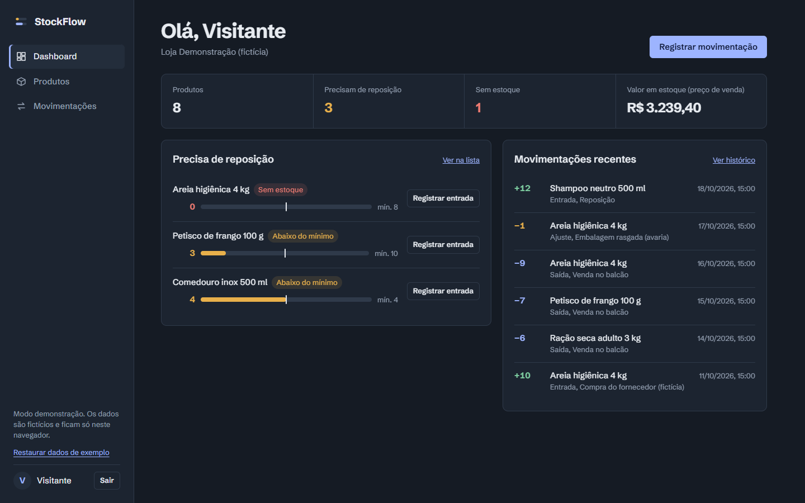
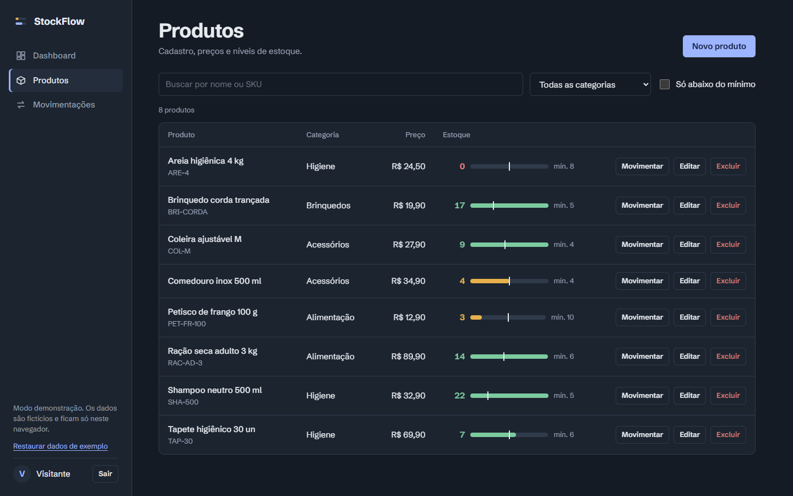
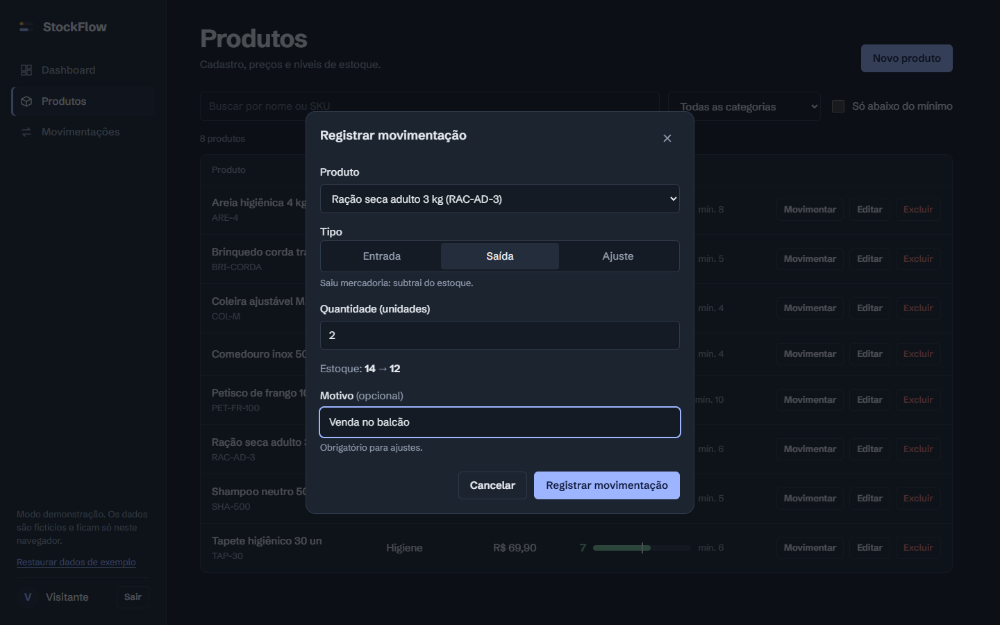
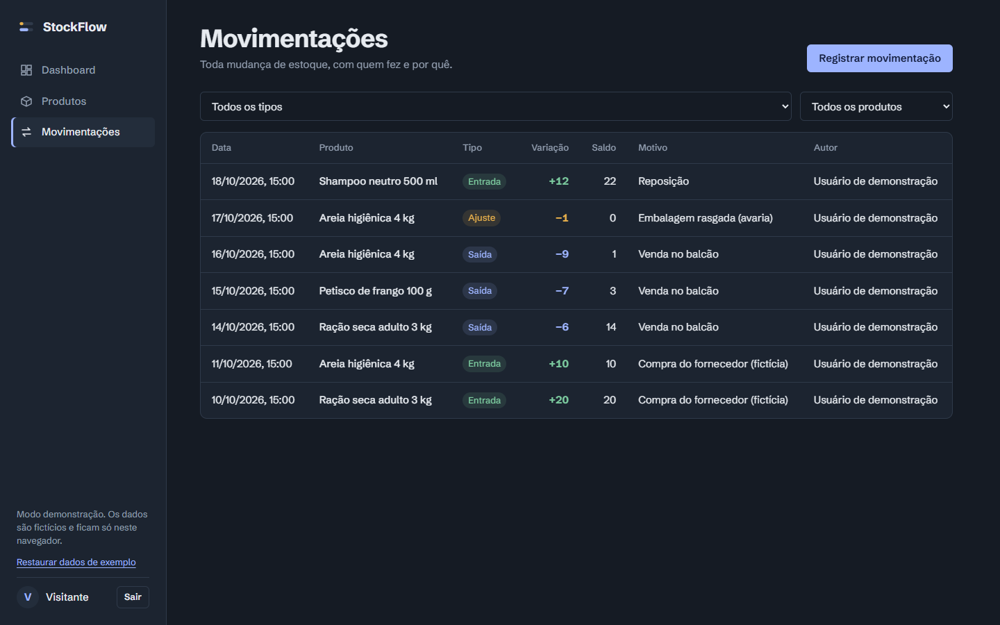
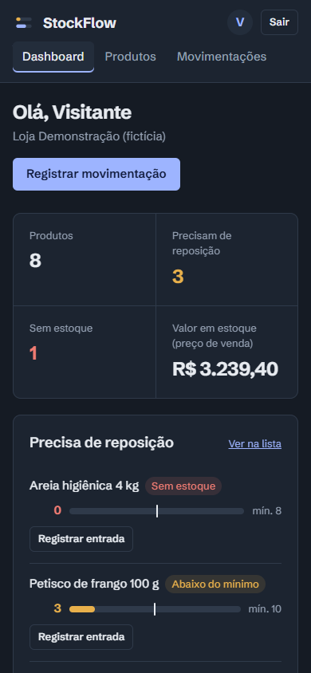

# StockFlow

Controle de estoque para pequenos comércios. Projeto de portfólio da **Penchel.Dev**.

O app tem **dois modos**:

- **Conta real:** login com e-mail e senha (Supabase Auth). Os dados ficam num PostgreSQL com Row Level Security, e cada loja só enxerga os próprios dados.
- **Demonstração:** sem cadastro, com dados fictícios que ficam só no navegador. É para quem quer conhecer o projeto rapidinho.

## Demonstração

> 🔗 **Link público:** _(adicione aqui depois de publicar; veja [`docs/etapa-7-publicacao.md`](docs/etapa-7-publicacao.md))_

| Dashboard | Produtos |
|---|---|
|  |  |
| **Registrar movimentação** | **Histórico** |
|  |  |

<p align="center"></p>

_Todas as telas usam dados fictícios do modo demonstração._

## Problema e solução

Muitos comércios pequenos controlam o estoque de cabeça, no caderno ou em planilhas soltas, e só percebem que um produto acabou quando o cliente pede. O StockFlow registra cada entrada e saída e avisa quando um produto passa do estoque mínimo.

## Funcionalidades

- Criação de conta, login e logout, com a loja criada junto com a conta
- Cadastro, edição e exclusão de produtos, com confirmação antes de excluir
- Busca por nome ou SKU (ignorando acentos), filtro por categoria e filtro "só abaixo do mínimo"
- Entradas, saídas e ajustes, com prévia do saldo e histórico (quem, quando e por quê)
- Bloqueio de estoque negativo e de SKU duplicado, **garantido pelo banco**
- Dashboard com indicadores calculados, lista de reposição e movimentações recentes
- Estados de carregamento, vazio e erro (inclusive sem internet e com sessão expirada)
- Layout responsivo, foco visível no teclado e suporte a `prefers-reduced-motion`
- Animações com propósito: abertura com o logo, troca de página deslizando (View Transitions API), modal com entrada e saída e barras de estoque que enchem

## Tecnologias

HTML, CSS e JavaScript em módulos · Vite 8 · Supabase (PostgreSQL, Auth e RLS) · Vitest 5 · PGlite (testes do banco) · Vercel

## Como rodar

Pré-requisito: Node.js 18 ou mais recente.

```bash
cd stockflow
npm install
npm run dev
```

Abra o endereço mostrado no terminal (normalmente http://localhost:5173). **Sem configurar nada, só o modo demonstração aparece.** Para ativar as contas reais, siga [`docs/etapa-3-supabase.md`](docs/etapa-3-supabase.md).

> **Windows / PowerShell:** se aparecer `npm.ps1 cannot be loaded because running scripts is disabled`, use `npm.cmd` no lugar de `npm` (ex.: `npm.cmd run dev`). Outra opção é liberar scripts locais uma vez com `Set-ExecutionPolicy -Scope CurrentUser RemoteSigned`.

Para gerar a versão de produção: `npm run build` e depois `npm run preview`.

## Testes automatizados

```bash
npm test
```

São 71 testes ([Vitest](https://vitest.dev)) em `tests/`:

| Arquivo | O que verifica |
|---|---|
| `validators.test.js` | Preços em centavos (incluindo `0,10 + 0,20`), campos obrigatórios, SKU duplicado, quantidades inválidas |
| `services.test.js` | Regras do modo demonstração: estoque nunca negativo, "transação" que não grava nada quando falha, histórico, busca e dashboard |
| `database.test.js` | A **migration real** num PostgreSQL embutido: isolamento entre lojas (RLS), visitante sem acesso, quantidade que só muda pelas funções de estoque, estoque negativo bloqueado |

## Como testar à mão

1. **Demonstração:** clique em "Explorar a demonstração".
2. **Produtos → Novo produto**: tente salvar com campos vazios, preço `abc` e um SKU repetido (`RAC-AD-3`). Deve aparecer um erro em cada campo.
3. Cadastre um produto com quantidade inicial 5. Em **Movimentações**, ele aparece como entrada "Estoque inicial no cadastro".
4. Registre uma saída maior que o estoque. A prévia fica vermelha e o salvamento é bloqueado.
5. Recarregue a página (F5). Os dados continuam lá.
6. **Contas reais:** veja o roteiro em [`docs/etapa-3-supabase.md`](docs/etapa-3-supabase.md#manuais-depois-de-configurar), que inclui o teste entre duas lojas.

## Estrutura

```text
src/
├── main.js              # inicia a sessão e decide qual página mostrar (protege áreas privadas)
├── pages/               # telas: login, dashboard, produtos, movimentações e estados comuns
├── components/          # menu, modal, toast, formulários e medidor de estoque
├── services/
│   ├── products.js      # o que as telas chamam; escolhe o modo pela sessão
│   ├── inventory.js
│   ├── session.js       # login, cadastro, demonstração e logout
│   ├── supabase.js      # cliente Supabase (só com .env)
│   ├── local/           # modo demonstração (localStorage)
│   └── remote/          # modo conta real (Supabase)
├── utils/               # formatação, validação, busca e cálculos do dashboard
└── styles/              # base (tokens), layout e componentes
supabase/migrations/     # tabelas, RLS e funções SQL
tests/                   # testes automatizados
docs/                    # planejamento, guia do Supabase, publicação, roteiro do vídeo e screenshots
```

## Conceitos para estudar

- **Separação de camadas:** as telas chamam `services/products.js` e não sabem se os dados vêm do navegador ou do banco.
- **Row Level Security (RLS):** o banco filtra as linhas por usuário, então o navegador não consegue "pedir dados de outra loja".
- **Funções SQL e transações:** `register_movement` valida, atualiza o saldo e grava o histórico juntos, e `for update` evita problemas quando duas pessoas mexem ao mesmo tempo.
- **Privilégios por coluna:** o usuário pode editar o nome do produto, mas não a quantidade.
- **JWT e sessão:** o Supabase guarda o token e o app reage quando a sessão expira.
- **Validação em duas camadas:** a do navegador melhora a experiência; a do banco é a que protege.
- **Centavos inteiros:** por que `0.1 + 0.2 !== 0.3` em JavaScript.
- **XSS:** por que todo texto do usuário passa por `esc()` antes de ir para o HTML.

## Erros comuns

- **Só aparece "Explorar a demonstração":** falta o `.env`, ou o `npm run dev` não foi reiniciado depois de criá-lo.
- **"E-mail ou senha incorretos" logo depois de criar a conta:** confirme o e-mail pelo link ou desative a confirmação (veja o guia).
- **"Sem conexão com o servidor":** internet, URL errada no `.env` ou projeto Supabase pausado (projetos gratuitos pausam depois de um tempo sem uso).
- **Erro "already exists" no SQL Editor:** a migration já tinha sido executada. Isso é esperado.
- **Dados da demonstração "sumiram":** o `localStorage` é por navegador e por endereço (`localhost` e `127.0.0.1` contam como diferentes).

## Limitações conhecidas

- Busca e filtros rodam no navegador. Basta para lojas pequenas, mas não para catálogos enormes.
- O histórico mostra as 500 movimentações mais recentes, sem paginação.
- Não há convite de funcionários (versão 3) nem recuperação de senha.
- O plano gratuito do Supabase não tem backup automático restaurável. Não use para dados comerciais reais sem rever isso.
- Os testes automatizados cobrem regras, serviços locais e o banco. A ligação entre as telas e o Supabase real foi testada só à mão.
- Vendas ainda não existem (versão 2).

## Segurança

- `.env` está no `.gitignore`. O `.env.example` só tem nomes de variáveis e valores ilustrativos.
- O frontend usa apenas a chave pública (anon/publishable). A chave `service_role` **nunca** deve ir para o frontend nem para o repositório.
- Cabeçalhos de segurança na publicação (`vercel.json`): Content Security Policy, HSTS, `nosniff`, Referrer-Policy e Permissions-Policy.
- `npm audit`: 0 vulnerabilidades. Acessibilidade verificada com axe-core: 0 problemas nas telas principais.
- Detalhes das proteções em [`docs/etapa-3-supabase.md`](docs/etapa-3-supabase.md#como-a-segurança-funciona).
